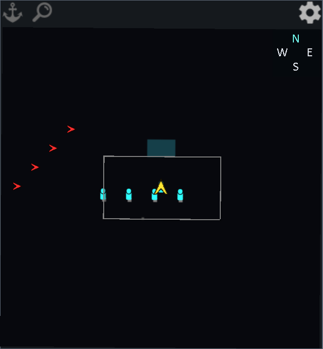
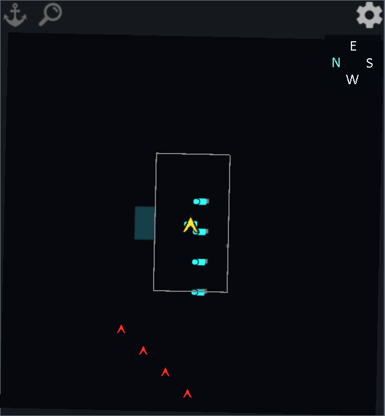

# ISORIM FPS Control Bridge (CE & Vanilla)

Version **0.8.21-vehicle-crew-r1** · [Steam Workshop](https://steamcommunity.com/sharedfiles/filedetails/?id=3824599915)

Hold Alt to view crew spaces on Vehicle Framework vehicles within 40 cells in 3D. Calibrated models use their measured positions. Other models use the vehicle’s native role hitboxes or an estimate based on the hull and seats. When no crew member can act, a hostile vehicle becomes unowned and ejects surviving occupants. Airborne ejections use the Strike Framework’s parachute and crash sequence.

按住 Alt 查看三维距离 40 格以内的 Vehicle Framework 载具乘员位置。已有实测坐标的车型使用实测值，其余车型使用原生席位格或按车体与席位估算。敌方载具所有乘员失能时变为无主，并弹出仍在舱内的幸存者。空中弹出沿用立体打击框架的跳伞和坠机流程。

The GitHub Releases page provides an installable ZIP. Extract its mod folder into RimWorld’s Mods directory. See Mod/About/About.xml for requirements.

GitHub Releases 提供可安装压缩包。解压后把模组文件夹放进 RimWorld 的 Mods 目录。

## In-game screenshots / 实机截图

| Dub’s · North / 朝北 | Dub’s · East / 朝东 |
|---|---|
|  |  |

[Built-in minimap / 内置小地图](Screenshots/0820-built-in-minimap.png) · [Badger crew volumes / Badger 乘员体积](Screenshots/0820-alt-crew-volumes.png) · [Warbird pilot volume / Warbird 飞行员体积](Screenshots/0820-alt-warbird.png)

## Build the FPS bridge

```powershell
dotnet build Source/HSK.FpsBridge.csproj -c Release "-p:RimWorldDir=<SteamLibrary>/steamapps/common/RimWorld" "-p:WorkshopDir=<SteamLibrary>/steamapps/workshop/content/294100"
```
